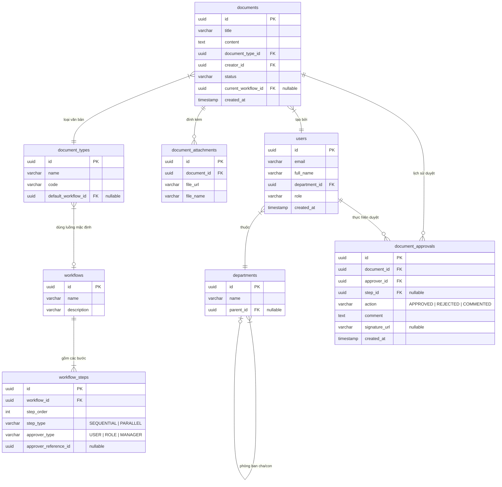

# 🗄️ Thiết kế Cơ sở dữ liệu (Database Schema)
**Dự án:** Hệ thống Ký duyệt & Văn bản Nội bộ
**Database:** PostgreSQL
**ORM Đề xuất:** Prisma ORM (Giúp gõ type an toàn tuyệt đối với TypeScript) hoặc Drizzle ORM (Tối ưu hiệu năng, thuần SQL).

---

## 1. Sơ đồ Thực thể Liên kết (ERD)

---

## 2. Chi tiết các Bảng cốt lõi (Core Tables)

### A. Nhóm Tổ chức & Định danh (Organization)
**1. Bảng `departments` (Phòng ban)**
- `id` (UUID, PK)
- `name` (String): Tên phòng ban (VD: Phòng IT, Ban Giám Đốc).
- `parent_id` (UUID, FK, Nullable): Hỗ trợ mô hình cây tổ chức (Phòng ban con thuộc Ban cha).

**2. Bảng `users` (Người dùng)**
- `id` (UUID, PK)
- `email` (String, Unique, Indexed)
- `password_hash` (String)
- `full_name` (String)
- `department_id` (UUID, FK)
- `role` (Enum): `ADMIN`, `MANAGER`, `EMPLOYEE`.

### B. Nhóm Cấu hình Luồng duyệt (Workflow Template)
**3. Bảng `workflows` (Luồng duyệt mẫu)**
- `id` (UUID, PK)
- `name` (String): VD "Quy trình mua sắm thiết bị", "Xin nghỉ phép".

**4. Bảng `workflow_steps` (Các bước trong luồng)**
- `id` (UUID, PK)
- `workflow_id` (UUID, FK, Indexed)
- `step_order` (Integer): Thứ tự duyệt (1, 2, 3...).
- `step_type` (Enum): `SEQUENTIAL` (Duyệt tuần tự), `PARALLEL` (Duyệt song song).
- `approver_type` (Enum): Xác định người duyệt là ai (`SPECIFIC_USER`, `DEPARTMENT_MANAGER`, `ROLE`).
- `approver_reference_id` (UUID, Nullable): Chứa ID của User hoặc Role tương ứng với type.

### C. Nhóm Văn bản & Xử lý (Documents)
**5. Bảng `documents` (Tờ trình / Văn bản)**
- `id` (UUID, PK)
- `title` (String)
- `content` (Text): Nội dung tóm tắt hoặc HTML.
- `document_type_id` (UUID, FK)
- `creator_id` (UUID, FK, Indexed): Người tạo.
- `status` (Enum, Indexed): `DRAFT`, `PENDING`, `APPROVED`, `REJECTED`, `COMPLETED`.
- `current_step_order` (Integer): Bước hiện tại đang chờ duyệt.

**6. Bảng `document_approvals` (Lịch sử Ký/Duyệt)**
- `id` (UUID, PK)
- `document_id` (UUID, FK, Indexed)
- `approver_id` (UUID, FK)
- `step_id` (UUID, FK): Ánh xạ lại bước duyệt nào.
- `action` (Enum): `APPROVED`, `REJECTED`, `FORWARDED`, `COMMENTED`.
- `comment` (Text)
- `signature_url` (String, Nullable): Lưu đường dẫn ảnh chữ ký hoặc file chứng nhận (nếu có).

---

## 3. Chiến lược Tối ưu (Indexing & Performance)
Dựa theo `database-design` best practices:
1. **Indexes:** 
   - Thêm B-Tree Index cho `documents(creator_id)` và `documents(status)` để truy vấn danh sách "Văn bản của tôi" hoặc "Đang chờ duyệt" cực nhanh.
   - Thêm Index cho `document_approvals(document_id)` vì đây là bảng nối (join) liên tục để xem tiến độ.
2. **Soft Delete:** Thêm trường `deleted_at` cho các bảng như `users`, `documents` để tránh mất dữ liệu quan trọng khi có thao tác xóa.
3. **JSONB (Tùy chọn mở rộng):** Nếu sau này có các form động (Dynamic Forms) cho từng loại văn bản, có thể thêm 1 cột `metadata` kiểu `JSONB` trong bảng `documents`.
